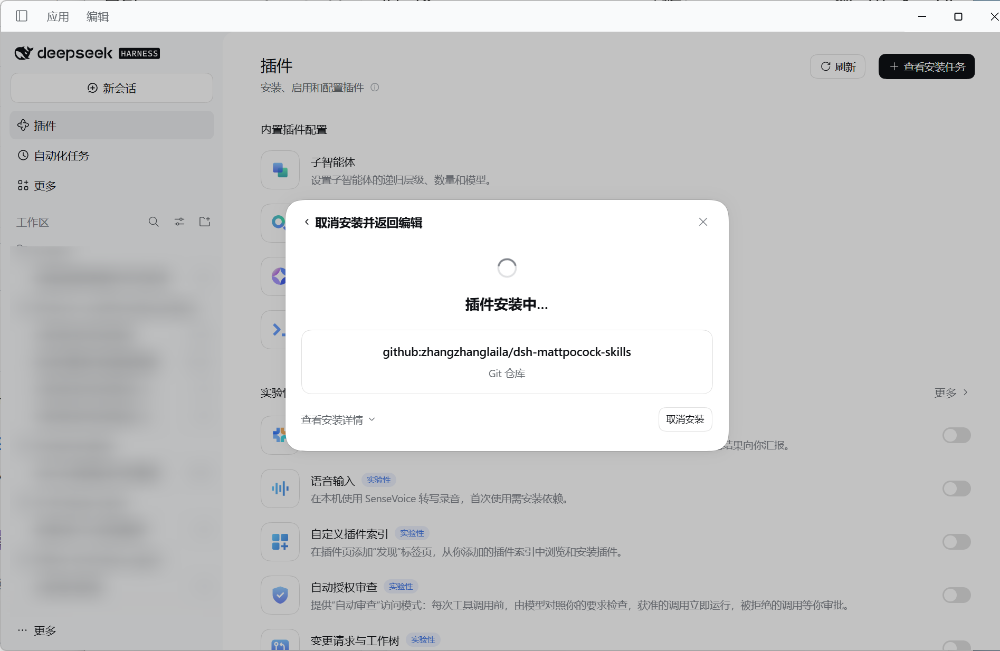

<h1 align="center">dsh-mattpocock-skills</h1>

<div align="center">

**Matt Pocock 的技能，原封不动地进入 DeepSeek Harness。**

让 [mattpocock/skills](https://github.com/mattpocock/skills) 的 27 个技能，以**逐字节一致**的方式成为 DSH 的一个插件层。

*Verbatim. Byte for byte. No UI. No runtime dependencies.*

<br>

[](CHANGELOG.md) [](skills/) [](https://github.com/mattpocock/skills/releases/tag/v1.3.2) [](lib/index.js) [](catalog.json) [](package.json) [](LICENSE)

</div>

> 非官方移植。技能内容 © Matt Pocock，MIT。本包只做一件事：把这份内容按 DSH 的技能契约装进去，

---

<h2 align="center"><sub>SCOPE</sub><br>范围与承诺</h2>

本包不是"把技能抄一遍"，而是把上游作为**唯一事实来源**，自己只承担三件事：发现、按需读取、注册。
因此下面四条不是形容词，而是可执行的断言：

| 承诺 | 实现 | 证据 |
| --- | --- | --- |
| 正文与官方一字不差 | 同步脚本整目录复制，逐文件记录 SHA-256 | `node scripts/verify.mjs --upstream <clone>` |
| 技能集合与官方插件一致 | 清单真源 = 上游 `.claude-plugin/plugin.json` 的 `skills` 数组 | 同上，名称集合双向比对 |
| 调用语义与官方一致 | `disable-model-invocation: true` → `modelInvocable: false` | verify 断言 11 模型可调 / 16 仅用户可调 |
| 不引入任何运行时依赖 | `lib/index.js` 只 import `node:` 内置模块 | verify 扫描 import 语句 |

**明确不做**：不提供面板、不注入 UI、插件自身不写文件也不联网、不改写技能措辞。
`skills/` 里每个字节都来自上游，本包对它的唯一加工是把 CRLF 归一为 LF（见 `.gitattributes`）。
（技能运行时会按自身内容读写文件，那是技能的行为，不是插件的。）

<h2 align="center"><sub>INSTALL</sub><br>安装</h2>

### 方式 A · 在 DSH 界面里装（推荐）

1. 打开 DSH，左侧进 **「插件」**；
2. 安装源选 **「Git 仓库」**，输入框里粘贴这一行（**就是这串，别改**）：

```
github:zhangzhanglaila/dsh-mattpocock-skills
```

3. 选装进的 profile（桌面应用是 `desktop`），点安装，等它跑完。

<p align="center"></p>

<p align="center"><sub>安装对话框：来源标记为「Git 仓库」，输入内容就是 <code>github:zhangzhanglaila/dsh-mattpocock-skills</code></sub></p>

### 方式 B · 命令行

```bash
# ① 安装 DSH CLI（已装跳过）
npm install -g @deepseek-ai/dsh

# ② 装进你实际启动应用所用的 profile —— 装错 profile 等于没装
dsh plugin --profile desktop add github:zhangzhanglaila/dsh-mattpocock-skills

# ③ 确认 bundle 层已组合（应出现 - id: dsh-mattpocock-skills）
dsh --profile desktop --dump-config
```

### 方式 C · 本地开发（链接方式）

```bash
dsh plugin --profile desktop add D:\Code\dsh-mattpocock-skills
```

> A / B 装的是 Git 副本，**改本地文件不会生效**；C 是链接，改完即时生效。
> 两种方式**不能同时装**——切换前先 `dsh plugin --profile desktop remove dsh-mattpocock-skills`，
> 否则会撞上 `EPERM ... rename ..._tmp_ -> dsh-mattpocock-skills`（Windows 不允许覆盖已有的目录链接）。

卸载：`dsh plugin --profile desktop remove dsh-mattpocock-skills`。
profile 名按你的入口填：桌面应用是 `desktop`，`dsh web` 是 `web`。

安装完成后，技能进入 `ctx.skills` 的 **host 层**，因此每一个 agent preset 的作用域链都会合并它们。

**装之前确认这四件事**

| 条件 | 为什么 | 不满足时的报错 |
| --- | --- | --- |
| 机器装了 `git` | pnpm 处理 `github:` 依赖要先 `git ls-remote` | `ERR_PNPM_GIT_RESOLVE_FAILED` |
| 能访问 `github.com` | 代码要从 GitHub 拉取 | `ETIMEDOUT` / `504` |
| DSH `>= 0.1.0-rc.6` | `package.json` 的 `engines.dsh` | 安装被拦下 |
| profile 选对 | 装错 profile 等于没装 | 重启也看不到技能 |

**装完怎么确认**

- 插件页里显示已启用；`dsh --profile <name> --dump-config` 输出 `- id: dsh-mattpocock-skills`；
- 新会话的技能目录出现 11 个模型可调技能，输入框敲 `/` 能看到全部 27 个。

**实测环境**

| 环境 | 结果 |
| --- | --- |
| DSH 桌面应用 `0.2.2-rc.1` / profile 运行时 `0.1.1-rc.2` | 27 个技能可发现；`skill research` 载入正常；`handoff` 按策略拒绝模型调用 |
| `dsh` CLI `0.1.1-rc.2` 组合 profile | `--dump-config` 输出 `- id: dsh-mattpocock-skills` |

<h2 align="center"><sub>USAGE</sub><br>使用</h2>

与官方插件在 Claude Code 里的用法一致，分两条入口：

| 入口 | 形态 | 技能 |
| --- | --- | --- |
| 模型 | 技能目录 + `skill` 工具按名加载 | 11 个：`tdd`、`code-review`、`grilling`、`research`、`prototype`、`domain-modeling`、`codebase-design`、`pr`、`wizard`、`diagnosing-bugs`、`writing-for-agents` |
| 用户 | 输入框敲 `/` 选择，插入 `/技能名` | 全部 27 个；其中 16 个标记为「仅用户」，模型不会自动加载 |

技能之间互相点名（`Call the Skill tool with "tdd"`）保留原文，DSH 的对应工具就是 `skill`，链条照常运行。
技能内引用的同目录文件（`PHASE-BOUNDARIES.md`、`GLOSSARY-FORMAT.md` 等）通过 `resourceBase`
解析，加载时能看到准确的基础目录。

<h2 align="center"><sub>VERIFY</sub><br>自证</h2>

```bash
node scripts/verify.mjs                                   # 自带清单校验
node scripts/verify.mjs --upstream D:\Code\clone\skills    # 再与上游逐字节比对
```

三重独立检查，任何一项不过即退出码 1（`prepublishOnly` 也会跑）：

1. **字节** —— `catalog.json` 记录的每个文件都存在且 SHA-256 相符；`skills/` 里没有任何清单外文件。
2. **正文** —— 用另一套独立实现切出 `SKILL.md` 正文，哈希与 `contentSha` 一致且非空。
3. **协议** —— 把 provider 挂到假的 `ctx.skills` 上，逐条核对注册表契约：`provider` 自洽、
   `rank` 有限、`source` 为字符串、名称为 kebab-case、`resourceBase` 指向技能目录、abort 后返回空。

<h2 align="center"><sub>SYNC</sub><br>跟随上游</h2>

```bash
node scripts/sync-upstream.mjs --from D:\Code\clone\skills
node scripts/verify.mjs --upstream D:\Code\clone\skills
```

同步脚本的行为是确定的：读上游发布清单 → 整目录复制 → 严格解析 frontmatter（只认上游实际使用的
YAML 子集，折叠标量、列表、锚点一律报错而非猜测）→ 重写 `catalog.json`（含上游 commit/version
与逐文件哈希）→ 删除上游已下架的技能目录。上游加技能、删技能、改正文，重跑一次即可跟上。

<h2 align="center"><sub>SKILLS</sub><br>技能清单</h2>

27 个，顺序与上游发布清单一致；`仅用户` 表示模型不可自动调用。

| 技能 | 调用方 | 用途 |
| --- | --- | --- |
| `ask-matt` | 仅用户 | 路由器：描述处境，给出匹配的技能或技能序列 |
| `diagnosing-bugs` | 模型 + 用户 | 硬 bug / 性能回归的六阶段诊断循环 |
| `grill-with-docs` | 仅用户 | 拷问计划，同时把词汇与决策写进仓库 |
| `triage` | 仅用户 | 让 issue 走完 triage 角色状态机 |
| `improve-codebase-architecture` | 仅用户 | 扫描加深机会，产出可视化报告 |
| `setup-matt-pocock-skills` | 仅用户 | 配置 issue tracker、triage 标签、领域文档布局 |
| `tdd` | 模型 + 用户 | 红 → 绿，以及值得留下的测试标准 |
| `to-spec` | 仅用户 | 把对话固化成 spec 并发布到 tracker |
| `to-tickets` | 仅用户 | 拆成带阻塞边的 tracer-bullet 票 |
| `wayfinder` | 仅用户 | 跨会话的大工程画成决策票地图 |
| `implement` | 仅用户 | 按 spec / 票实现，驱动 tdd 与 code-review |
| `implement-spec` | 仅用户 | 整份 spec 一次跑完，实现者子代理并行 |
| `prototype` | 模型 + 用户 | 一次性代码回答一个设计问题 |
| `research` | 模型 + 用户 | 只读一手资料，把结论写成带引用的 Markdown |
| `domain-modeling` | 模型 + 用户 | 打磨通用语言、`GLOSSARY.md` 与 ADR |
| `codebase-design` | 模型 + 用户 | module / interface / depth / seam 词汇表 |
| `code-review` | 模型 + 用户 | Standards + Spec 两轴评审 |
| `pr` | 模型 + 用户 | 写 PR 正文 |
| `retro` | 仅用户 | 会话复盘：改环境，不改代码 |
| `wizard` | 模型 + 用户 | 生成带人走流程的交互式 bash 向导 |
| `grill-me` | 仅用户 | 拷问入口，指向 `grilling` |
| `grilling` | 模型 + 用户 | 拷问的通用实现 |
| `handoff` | 仅用户 | 把对话压成交接文档 |
| `teach` | 仅用户 | 在工作区里跨会话教学 |
| `to-questionnaire` | 仅用户 | 把决定变成问卷交给别人填 |
| `wait-what` | 仅用户 | 上一条没听懂，重讲一遍 |
| `writing-for-agents` | 模型 + 用户 | 写给 agent 看的文档怎么写 |

<h2 align="center"><sub>DESIGN</sub><br>设计取舍</h2>

三个决定，都是为了让"和官方一样"可维护：

**一、内容不改写。** 把 `GLOSSARY.md` 改名回 `CONTEXT.md`、把 `Call the Skill tool with "tdd"`
削成 `use tdd`、删掉"先抓 ticket 再开工"——每一步都很像适配，断的却是技能之间的链条。
适配只发生在边界：frontmatter → 调用策略，目录 → `resourceBase`。

**二、`rank` 定为 350。** DSH 的优先级是数字越小越优先：项目 `.dsh/skills` 100、项目
`.agents/skills` 200、`custom` 300、用户 `~/.dsh/skills` 400、用户 `~/.agents/skills` 500、
内置 bundled 600。取 350 意味着：压过家目录里的旧副本，但仍让项目自己的技能覆盖它。

**三、发现期不解析 YAML。** 上游有带转义引号的长 `description`。解析放在同步期一次做完，
产物是 `catalog.json`；运行时只做"读文件 + 切掉 frontmatter"，切法与
`@deepseek-ai/dsh-skill-filesystem` 一致。代价是多一个构建产物，收益是运行时零依赖、
正文与 DSH 自身读文件时完全等价。

<h2 align="center"><sub>LAYOUT</sub><br>目录结构</h2>

```
lib/index.js                Cordis 插件：注册一个 host 层 skill provider
skills/<name>/              上游技能原文（含引用文件与 agents/openai.yaml）
catalog.json                同步产物：frontmatter 解析结果 + 逐文件 SHA-256
cordis.patch.yml            bundle 层：把插件行插入 profile
dsh.plugin.json             插件清单（27 个技能名）
scripts/sync-upstream.mjs   从上游同步
scripts/verify.mjs          字节 / 正文 / 协议三重校验
```

注册信息：provider 名 `dsh-mattpocock-skills`（与包名一致）、`rank` 350、
`source` `bundled-mattpocock`。

<h2 align="center"><sub>CREDITS</sub><br>许可与署名</h2>

MIT。技能内容 © Matt Pocock（[mattpocock/skills](https://github.com/mattpocock/skills)，MIT）；
DSH 适配部分 © dsh-mattpocock-skills contributors。完整许可见 [LICENSE](LICENSE)。
